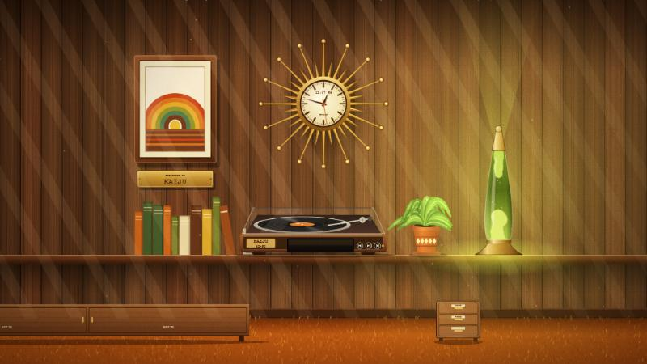

# KAIJU Retro Den

A 1970s rec-room for your Windows desktop. The wallpaper is a wood-paneled room with a lava lamp, a sunburst clock and a hi-fi turntable, and **everything in it is clickable**:

| Prop | What it does |
|---|---|
| **TV** (wood cabinet, rabbit ears) | Plays your movies on its own little screen, with a retro CRT filter. Click the picture to start, click again to pause, mouse wheel for volume, hover for a scrub bar and a fullscreen button. It remembers the movie and the spot. |
| **KAIJU SYSTEMS console** | Click it for the game list (SNES and GameCube/Wii). Pick a game and it plays *inside the TV*. Click the console again to stop; your movie comes back where it left off. |
| **Turntable** | Shows what iTunes or Spotify is playing, with prev / play / next buttons. |
| **File cabinet** | Your Desktop icons, tidied into the cabinet: click it and a drawer opens with your shortcuts and files as a plain list. Also FIX DESKTOP, RECYCLE BIN and POWER OFF. |
| **Gauge panel** | CPU, memory, free disk space, uptime and network speed on needle dials. |
| **Lava lamp, clock** | Just for looking at. The lamp slowly cycles through seven colours; the clock keeps real time. |

It runs on **one screen** (your primary monitor). Other monitors are left alone.



*The wallpaper by itself. Rainmeter adds the TV, console, gauges and the cabinet drawer on top.*

> **Status: v0.1, early.** Built and tested on one Windows 11 PC at 1920x1080. The installer has been tested in a sandbox but **not yet on a clean machine**, and the controller button mappings have never been pressed. See [Known limits](TROUBLESHOOTING.md#known-limits). Bug reports are welcome.

## What you need

* Windows 10 or 11
* **[Wallpaper Engine](https://store.steampowered.com/app/431960/Wallpaper_Engine/)** on Steam (paid, about 4 USD). This is the only thing you have to buy.
* Python 3 with tkinter (the installer can add it for you with winget)
* Your own movies, and your own game files (ROMs) if you want the console

The installer downloads the rest (mpv, Rainmeter, ShaderGlass, Snes9x, Dolphin) from their official sources and checks each file against a fixed checksum. **No games, no ROMs, no BIOS files and no movies are included or downloaded.**

## Install

Short version (full guide: [INSTALL.md](INSTALL.md)):

1. Install Wallpaper Engine from Steam and start it once.
2. Download this repository (green **Code** button, then **Download ZIP**) and unzip it.
3. Right-click `install.ps1` and choose **Run with PowerShell**, or run in a terminal:
   ```
   powershell -ExecutionPolicy Bypass -File install.ps1
   ```
4. Answer the questions (where your movies and games are, what the brass plaque should say, iTunes or Spotify). Want to look first? Add `-DryRun` and nothing is changed.

To remove everything again: `uninstall.ps1` (your Desktop items are put back, nothing is deleted).

## How it works

Wallpaper Engine draws the room (a web wallpaper painted entirely in code, no image files). Rainmeter lays the clickable props, the gauges, the TV frame and the console over it. mpv is the TV's picture tube, and the emulators run in a window that a PowerShell script shrinks and fits into the TV screen. A small background watcher pauses the TV and hides the widgets when you run a fullscreen app.

Everything the installer sets up lives in one folder (`%LOCALAPPDATA%\KaijuRetroDen` by default). One file, `config.json`, holds your choices.

## Credits and licenses

The code in this repository is MIT licensed ([LICENSE](LICENSE)). The tools the installer downloads keep their own licenses, listed in [NOTICE.md](NOTICE.md). "KAIJU" is a made-up brand and not a real company.
