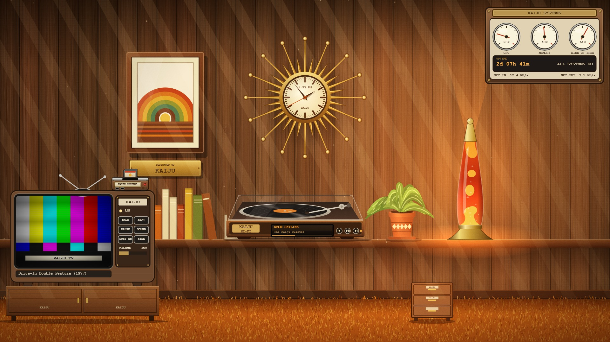
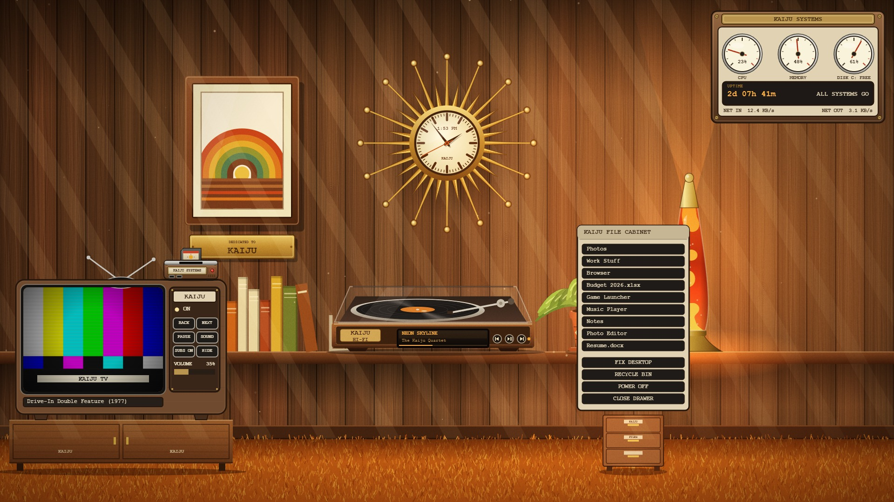

# KAIJU Retro Den

A 1970s rec-room for your Windows desktop. The wallpaper is a wood-paneled room with a TV, a game console, a hi-fi turntable, a file cabinet, a lava lamp and a sunburst clock, and **everything in it is clickable**.



*An illustration of the finished room, drawn from this project's own files. The TV shows a test card because **no movies come with the project**: the real TV plays your own files.*

## What you get, and what you bring

**This project is the room and its controls. It does not include any movies, music or games.**

| You bring | What the room does with it |
|---|---|
| **Your own movie files**, in a folder you choose | The TV plays them on its little screen, with a retro CRT filter. It remembers the movie and the spot. |
| **Your own music**, in iTunes or the Spotify desktop app you already use (with your own account or library) | The turntable *shows* what is playing and has previous / play / next buttons. It does not play, stream or provide music itself. |
| **Your own game files (ROMs)** for SNES and GameCube/Wii, in folders you choose | The console lists them and plays them inside the TV, using the emulators the installer sets up. |
| **Your own Desktop icons** | They are tidied into the file cabinet (a plain-text drawer). |

The installer downloads only the free tools that run the room (mpv, Rainmeter, ShaderGlass, Snes9x, Dolphin), from their official sources. You set up your own controller or keys in each emulator.

## What each prop does

| Prop | What it does |
|---|---|
| **TV** (wood cabinet, rabbit ears) | Click the picture to start your movie, click again to pause, mouse wheel for volume, hover for a scrub bar and a fullscreen button. |
| **KAIJU SYSTEMS console** | Click it for the game list. Pick a game and it plays *inside the TV*. Click the console again to stop; your movie comes back where it left off. |
| **Turntable** | Shows the song and artist from iTunes or Spotify, with prev / play / next. |
| **File cabinet** | Click it and a drawer opens with your shortcuts and files as a plain list (below), plus FIX DESKTOP, RECYCLE BIN and POWER OFF. |
| **Gauge panel** | CPU, memory, free disk space, uptime and network speed on needle dials. |
| **Lava lamp, clock** | Just for looking at. The lamp slowly cycles through seven colours; the clock keeps real time. |



It runs on **one screen** (your primary monitor). Other monitors are left alone.

> **Status: v0.1, early.** Built and tested on one Windows 11 PC at 1920x1080. The installer has been tested in a sandbox but **not yet on a clean machine**. See [Known limits](TROUBLESHOOTING.md#known-limits). Bug reports are welcome.

## What you need

* Windows 10 or 11
* **[Wallpaper Engine](https://store.steampowered.com/app/431960/Wallpaper_Engine/)** on Steam (paid, about 4 USD). This is the only thing you have to buy.
* Python 3 with tkinter (the installer can add it for you with winget)
* Your own movie files for the TV, your own game files (ROMs) if you want the console, and your own iTunes library or Spotify account if you want the turntable. **None of these are provided.**
* A controller or keyboard of your choice for games: you set up the buttons yourself in each emulator (see [Controls for games](TROUBLESHOOTING.md#controls-for-games))

The installer downloads the rest (mpv, Rainmeter, ShaderGlass, Snes9x, Dolphin) from their official sources and checks each file against a fixed checksum. **No games, ROMs, BIOS files, movies or music are included, downloaded or streamed by this project.** It only plays and shows what you already have.

## Install

Short version (full guide: [INSTALL.md](INSTALL.md)):

1. Install Wallpaper Engine from Steam and start it once.
2. Download this repository (green **Code** button, then **Download ZIP**) and unzip it.
3. Right-click `install.ps1` and choose **Run with PowerShell**, or run in a terminal:
   ```
   powershell -ExecutionPolicy Bypass -File install.ps1
   ```
4. Answer the questions (where your movies and games are, what the brass plaque should say, iTunes or Spotify). Want to look first? Add `-DryRun` and nothing is changed.

To remove everything again: `uninstall.ps1` (your Desktop items are put back, nothing is deleted).

## How it works

Wallpaper Engine draws the room (a web wallpaper painted entirely in code, no image files). Rainmeter lays the clickable props, the gauges, the TV frame and the console over it. mpv is the TV's picture tube, and the emulators run in a window that a PowerShell script shrinks and fits into the TV screen. A small background watcher pauses the TV and hides the widgets when you run a fullscreen app.

Everything the installer sets up lives in one folder (`%LOCALAPPDATA%\KaijuRetroDen` by default). One file, `config.json`, holds your choices.

## Credits and licenses

The code in this repository is MIT licensed ([LICENSE](LICENSE)). The tools the installer downloads keep their own licenses, listed in [NOTICE.md](NOTICE.md). "KAIJU" is a made-up brand and not a real company.
